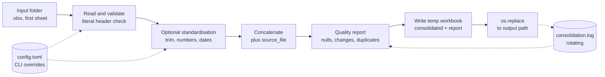
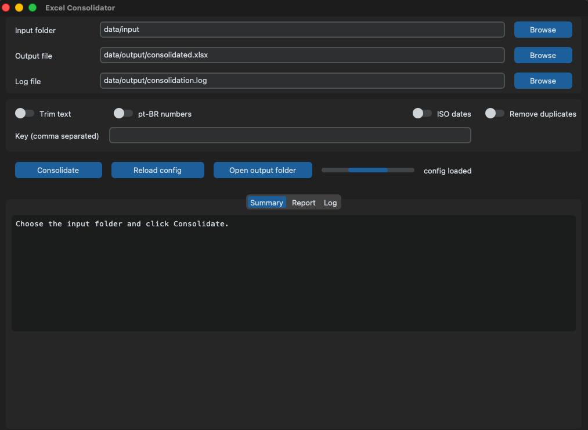

# Excel Consolidator

Consolidate every `.xlsx` file in a folder into one workbook, keep the origin of every row, and get a quality report that states exactly what changed.

[](https://github.com/rafacorte1/spreadsheet_automation/actions/workflows/ci.yml)


## What it does

The tool reads the first sheet of every `.xlsx` file directly inside an input folder, validates that the headers match, concatenates the rows in file-name order and adds a `source_file` column with the file name. Three optional rules standardise text, Brazilian-format numbers and dates. Duplicates can be counted, or removed by full row or by key.

The output is a workbook with two sheets: `consolidated` (the data) and `report` (a long-format quality report). The CLI prints four lines on success and writes a rotating log. Input files are never modified.

There is no database, no API and no scheduler. A local run is one command, and the same core is used by the optional desktop GUI.

## Features

- Deterministic input discovery: `.xlsx` files only, direct children of the folder, sorted by file name, `~$` lock files ignored.
- Structural validation up front: blank headers, duplicate headers, the reserved `source_file` column, missing data rows, unreadable files and incompatible headers are rejected before anything is written.
- Literal header comparison, so `Name` and `Name ` are different columns instead of silently merged.
- Origin tracking: every row keeps the name of the file it came from.
- Optional standardisation with per-column counters for changes and failures.
- Duplicate detection across files, by whole row or by key columns, with removal keeping the first occurrence in file and row order.
- Long-format report sheet with one row per metric, so it can be consumed without parsing text.
- Atomic output: a temporary workbook in the destination directory is fully written and then moved into place, so a failed run cannot damage the previous result.
- TOML configuration with explicit precedence, and a rotating log with one backup.
- Optional customtkinter GUI that reuses the CLI core and writes the same log file.

## Pipeline



## Quickstart

```bash
git clone https://github.com/rafacorte1/spreadsheet_automation.git
cd spreadsheet_automation
python3 -m venv .venv
source .venv/bin/activate
pip install -e ".[dev,ui]"
```

Consolidate the three sample files in `data/input` (7 rows in total):

```bash
python -m excel_consolidator --input data/input --output data/output/consolidated.xlsx
```

```text
files: 3
rows: 7
output: /path/to/spreadsheet_automation/data/output/consolidated.xlsx
quality: nulls=0 duplicates=0 removed=0 changed=0
```

With standardisation and duplicate removal by key:

```bash
python -m excel_consolidator --input data/input --output data/output/consolidated.xlsx \
  --trim-text --normalize-numbers --dates-iso --key product --remove-duplicates
```

Open the GUI (requires the `ui` extra):

```bash
python -m excel_consolidator.ui
```

## CLI reference

| Flag | Argument | Default | Effect |
|---|---|---|---|
| `--input` | `DIR` | `data/input` | Folder scanned for `.xlsx` files. Not recursive. |
| `--output` | `PATH` | `data/output/consolidated.xlsx` | Destination workbook. Parent directories are created. |
| `--trim-text` | none | off | Strip leading and trailing whitespace from text cells. |
| `--normalize-numbers` | none | off | Convert Brazilian-format numeric text to `int` or `float`. |
| `--dates-iso` | none | off | Convert recognised date text to `date` or `datetime` values. |
| `--key` | `COL1,COL2` | empty | Columns used to detect duplicates. Spaces and empty entries are trimmed. |
| `--remove-duplicates` | none | off | Remove later occurrences, keeping the first in file and row order. |
| `--config` | `PATH` | `config.toml` in the CWD if present | Configuration file. An explicit path must exist. |
| `--log-file` | `PATH` | `data/output/consolidation.log` | Log destination, overriding the configured path. |

Paths given on the command line, and the built-in defaults, are resolved relative to the current working directory.

`--key` is literal and case sensitive: `name` does not match a column called `Name`. An empty key (`--key ""` or `--key ,`) is always rejected. An unknown key column is an error only when duplicates are removed; without `--remove-duplicates` the key is ignored, the run continues, the log records a `WARNING` and the report counts duplicates in `identical_rows` mode.

## Output contract

A successful run prints exactly four lines to stdout:

```text
files: N
rows: N
output: PATH
quality: nulls=N duplicates=N removed=N changed=N
```

- `files` is the number of input files read.
- `rows` is the number of data rows in the output, after any duplicate removal.
- `output` is the absolute path of the workbook that was written.
- `quality` sums nulls, duplicate rows, removed rows and change operations across the whole run.

Exit codes:

| Code | Meaning |
|---|---|
| `0` | Success. |
| `1` | Consolidation or configuration error. `error: MESSAGE` is printed on stderr, no traceback, the previous output file is left untouched. |
| `2` | Invalid command-line arguments, reported by argparse. |

## Report schema

The `report` sheet has exactly five columns, in this order: `section`, `file`, `column`, `metric`, `value`. Files appear in alphabetical order, columns in the order of their own sheet, and zero counters are written explicitly so the layout does not shift between runs.

| Section | File | Column | Metric | Meaning |
|---|---|---|---|---|
| `summary` | file name | empty | `rows_read` | Data rows read from that file, before duplicate removal. |
| `nulls` | file name | column name | `nulls` | Cells that are `None`, empty or whitespace only, counted after standardisation and before duplicate removal. `source_file` is never included. |
| `standardization` | file name | column name | `changed_RULE`, `failed_RULE` | Per rule counters for active rules only (`trim_text`, `normalize_numbers`, `dates_iso`). |
| `duplicates` | empty | empty | `mode` | `identical_rows` or `key:a,b`. |
| `duplicates` | empty | empty | `duplicate_rows` | Duplicate rows found, before removal. |
| `duplicates` | empty | empty | `rows_removed` | Rows removed, zero when removal is off. |

Duplicate detection and null counting run on every execution, with or without flags. A clean run therefore still reports counters, and data that contains nulls or duplicates shows non-zero numbers even when no transformation was requested.

Two definitions are worth keeping apart: `rows_read` in the report is the input side, per file, while `rows` on stdout is the final output side, after removal.

## Data quality rules

All rules are optional and off by default. Rules run per cell in a fixed order: trim, numbers, dates. A non-text cell (number, boolean, date, `None`) is never touched by any rule. Empty and whitespace-only strings are never sent to the number or date converters and never count as failures.

**`--trim-text`** strips whitespace from both ends of text values. `"  Ana  "` becomes `"Ana"`. Inner spacing is preserved: `"  a  b  "` becomes `"a  b"`.

**`--normalize-numbers`** accepts Brazilian-format numeric text after stripping:

| Input | Output | Type |
|---|---|---|
| `"1.234,56"` | `1234.56` | `float` |
| `"1.234"` | `1234` | `int` |
| `"-1.234"` | `-1234` | `int` |
| `"-12,5"` | `-12.5` | `float` |
| `"12.345.678,9"` | `12345678.9` | `float` |
| `"42"` | `42` | `int` |

**`--dates-iso`** accepts four formats and returns a `date`, or a `datetime` when a time is present: `DD/MM/YYYY`, `YYYY-MM-DD`, `YYYY-MM-DD HH:MM:SS` and `DD/MM/YYYY HH:MM:SS`. Two-digit years are not accepted because they are ambiguous.

Limitations that follow from these rules, stated plainly:

- `"007"` becomes `7` with `--normalize-numbers`, losing the leading zeros. Do not enable the rule on code columns.
- Unsupported notations become failures and the value stays exactly as it was: `R$ 1.234,56`, `(10)`, `1e5`, `1.23.456`, `05/11/26`. There is no currency parsing, no accounting negatives, no scientific notation and no two-digit years.
- Failures are attributed per cell. A rule is counted as failed only when no conversion rule converted that cell. A cell that only lost whitespace under `--trim-text` still counts its conversion failures, because trimming is not a conversion.
- `changed` counts change operations per rule, so one cell can contribute twice: `" 42 "` with both trim and numbers counts two changes.
- Formulas are read through `data_only=True`. A formula without a cached value arrives as an empty cell, so it is counted as a null and never as a conversion failure.

## Configuration

The CLI reads `config.toml` from the current directory when it exists, or the file passed with `--config`. All keys are optional.

```toml
# Paths are relative to the directory of this file.
input = "data/input"
output = "data/output/consolidated.xlsx"
log_file = "data/output/consolidation.log"

[quality]
# Optional standardisation.
trim_text = false
normalize_numbers = false
dates_iso = false
# Optional duplicate removal and the columns used as key.
remove_duplicates = false
key = ["product"]
```

Precedence is explicit CLI value, then file, then built-in defaults. A flag that is not passed does not override the file, which is why `false` in the file is meaningful.

Paths written in the TOML are resolved relative to the TOML file itself, so running the CLI from another directory does not change the targets. CLI paths and defaults are resolved relative to the current working directory. Absolute paths are used as given.

Unknown keys, wrong types, a non-table `[quality]` and an empty path string are rejected with an error naming the offending key. A typo cannot silently disable a rule. An explicit `--config` path that does not exist is an error; a missing `config.toml` in the current directory is not.

The repository ships `config.example.toml` with every key. Copy it to `config.toml` and adjust the key to the columns of your inputs.

## Logging

The default log path is `data/output/consolidation.log`. `--log-file` overrides the configured path. The file is UTF-8, appended on every run, and rotated at roughly 1 MB with one backup (`consolidation.log.1`). The format is `YYYY-MM-DD HH:MM:SS LEVEL message`. There is no console handler: stdout belongs to the four-line contract.

Each successful run writes three INFO lines: `start` (resolved paths, active flags, key), `read` (file count and rows read) and `written` (final rows, counters, absolute output path). An ignored key adds a `WARNING`. Failures after the log is open are recorded as `ERROR error=MESSAGE`; configuration or log-opening failures are reported on stderr because the log is not available yet.

## GUI

`customtkinter` is an optional extra, installed with `pip install -e ".[ui]"`.

```bash
python -m excel_consolidator.ui
python -m excel_consolidator.ui --config path/to/config.toml
```

- Fields: input folder, output file and log file, each with a browse button; four quality switches; one key field.
- Buttons: Consolidate, Reload config, Open output folder.
- Summary tab: the same four lines the CLI prints, plus any error message.
- Report tab: the `section, file, column, metric, value` table of the last run.
- Log tab: the tail of the log file with a refresh button.

`config.toml` from the current directory is loaded when the window opens. Reload config re-reads the file; an invalid file shows the error in the Summary tab and keeps the previous defaults instead of opening empty.

The work runs in a worker thread and the result comes back through a `queue.Queue` polled with `after`, so the window does not freeze and no widget is touched from another thread. The GUI writes the log file at the configured path, exactly like the CLI. An unexpected exception in the worker becomes an error outcome shown in the window instead of a silent crash.



The window on open: input folder, output file and log file loaded from `config.toml`, the four quality switches, the key field and the three result tabs.

## Design decisions

**openpyxl instead of `pandas.read_excel`.** pandas renames duplicate headers (`id`, `id.1`) and turns blank cells into `Unnamed: N`. Both behaviours would hide rejections the tool is supposed to perform, so reading goes through openpyxl with `read_only=True` and `data_only=True`, and headers are validated before pandas sees them.

**Literal header comparison.** No strip, no casefold, no accent removal. `A`, ` A` and `a` are three different columns. Normalising silently is how two unrelated columns end up merged in a consolidated file.

**`dtype=object` on concatenation.** Without it pandas converts `None` to `NaN` and numeric strings to numbers, which would change the data during an operation that is supposed to only stack rows.

**Atomic write.** The workbook is built in a temporary file in the destination directory and moved with `os.replace` only after it is complete. A failure keeps the previous output byte for byte and removes the temporary. Building directly on the destination would leave a truncated workbook after an error.

**Long-format report.** Five columns, one row per metric, explicit zeroes. It survives new rules and new sections without breaking a reader, and it can be filtered or pivoted without parsing text.

**TOML paths relative to the TOML file.** A configuration file that means different things depending on where you launch the command is a source of silent mistakes. The config owns its paths; the command line owns the current directory.

**Output file mode 600.** `mkstemp` creates the temporary file with mode 0600 and `os.replace` preserves it. The report can contain sensitive data and the target is a single-user machine, so the restrictive mode is deliberate. It is not a bug to be fixed by widening permissions.

**Key validated only when it is used.** A stale key in `config.toml` used to kill a run that removed no duplicates. Now an unknown column is an error only with `--remove-duplicates`; without it the key is dropped with a `WARNING` and the report falls back to `identical_rows`. An empty key remains an error, because there is nothing to ignore.

## Project structure

```text
.
├── config.example.toml
├── docs
│   ├── HANDOFF.md
│   ├── briefs/                  # per-sprint briefs, kept as records
│   └── verification/            # independent verification scripts
├── pyproject.toml
├── src/excel_consolidator
│   ├── cli.py                   # argparse, config merge, logging, four stdout lines
│   ├── config.py                # TOML loading, validation, precedence
│   ├── consolidator.py          # concatenation, key validation, optional dedup
│   ├── errors.py                # ConsolidationError
│   ├── quality.py               # rules, per-column counters, duplicates
│   ├── reader.py                # discovery, first sheet, literal headers
│   ├── report.py                # long-format report sheet
│   ├── runlog.py                # rotating file handler
│   ├── writer.py                # two sheets, temp file plus os.replace
│   └── ui
│       ├── app.py               # widgets, worker thread, queue
│       ├── controller.py        # fields to RuntimeConfig to RunOutcome
│       └── __main__.py          # python -m excel_consolidator.ui
├── tests/                       # pytest suite with synthetic workbooks
└── data
    ├── input/                   # sample files
    └── output/                  # generated workbook and log (git-ignored)
```

## Testing

```bash
.venv/bin/python -m pytest tests -q
```

The suite has 182 tests covering discovery, header validation, standardisation, duplicate handling, report layout, atomic writes, configuration precedence, logging, the CLI contract and the GUI controller. GUI widget tests skip automatically when no display is available; the controller tests always run.

CI runs the same command on Ubuntu for Python 3.11, 3.12, 3.13 and 3.14.

## Limitations

- `.xlsx` only, first sheet only. No `.xls`, no `.csv`, no multi-sheet consolidation.
- Formulas are read through `data_only=True`: a formula without a cached value is read as empty. Formulas and cell formatting are not preserved in the output.
- Literal headers mean no case folding and no accent normalisation. Files must use the same column names, in any order.
- Duplicates are exact matches only. No fuzzy matching, no similarity threshold.
- `--normalize-numbers` changes `"007"` into `7`; unsupported notations are failures, not conversions.
- The whole dataset is held in memory. Large files have not been benchmarked.
- The output file is created with mode 600 by design.
- No scheduling. Runs are triggered by a command or by the GUI.

## Next steps

- Load test with large real spreadsheets to confirm memory behaviour and decide whether chunked reading is needed.
- Packaging (`.app` bundle, double-click launcher) is deferred by the product owner and not started.
- Revisit output permissions only if another local account needs to read the report.

## License

MIT. See [LICENSE](LICENSE).

## Docs index

| Document | Content |
|---|---|
| [docs/HANDOFF.md](docs/HANDOFF.md) | Sprint status, decisions with reasons, environment notes, known pitfalls. |
| [docs/briefs/](docs/briefs/) | The briefs each sprint was implemented against, kept as historical records. |
| [docs/verification/](docs/verification/) | Independent verification scripts that build synthetic inputs and assert the contract. |
