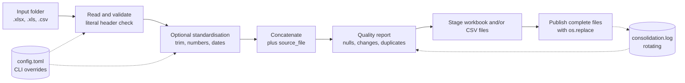
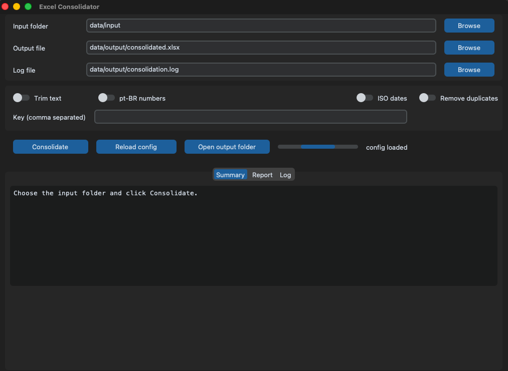

# Excel Consolidator

Consolidate `.xlsx`, legacy `.xls` and `.csv` files from a folder into a workbook, CSV files or both. Each export includes row origins and a quality report.

[](https://github.com/rafacorte1/spreadsheet_automation/actions/workflows/ci.yml)


## What it does

The tool reads the first worksheet of each Excel workbook and the records of each CSV file directly inside an input folder. It validates that the headers match, concatenates the rows in file-name order and adds a `source_file` column with the file name. Three optional rules standardise text, Brazilian-format numbers and dates. Duplicates can be counted, or removed by full row or by key.

The default export is a workbook with `consolidated` and `report` sheets. CSV exports contain the same data and report in two files. The CLI writes a rotating log and prints four lines on success, or one JSON object with `--json`. Input files are never modified.

There is no database, no API and no scheduler. A local run is one command, and the same core is used by the optional desktop GUI.

## Features

- Deterministic discovery of `.xlsx`, `.xls` and `.csv` files by case-insensitive extension. The reader scans the immediate folder, sorts by file name and ignores `~$` lock files.
- Structural validation up front: blank headers, duplicate headers, the reserved `source_file` column, missing data rows, unreadable files and incompatible headers are rejected before anything is written.
- Literal header comparison, so `Name` and `Name ` are different columns instead of silently merged.
- Origin tracking: every row keeps the name of the file it came from.
- Optional standardisation with per-column counters for changes and failures.
- Duplicate detection across files, by whole row or by key columns, with removal keeping the first occurrence in file and row order.
- Long-format quality report with one row per metric.
- Atomic file replacement. The tool stages all exports in the destination directory before publishing any of them and rejects destinations that overlap selected inputs.
- TOML configuration with explicit precedence, and a rotating log with one backup.
- Optional customtkinter GUI that reuses the CLI core and writes the same log file.

## Pipeline



## Quickstart

```bash
git clone https://github.com/rafacorte1/spreadsheet_automation.git
cd spreadsheet_automation
python3 -m venv .venv
source .venv/bin/activate
pip install -e ".[dev,ui]"
```

Consolidate the three sample files in `data/input` (7 rows in total):

```bash
python -m excel_consolidator --input data/input --output data/output/consolidated.xlsx
```

```text
files: 3
rows: 7
output: /path/to/spreadsheet_automation/data/output/consolidated.xlsx
quality: nulls=0 duplicates=0 removed=0 changed=0
```

With standardisation and duplicate removal by key:

```bash
python -m excel_consolidator --input data/input --output data/output/consolidated.xlsx \
  --trim-text --normalize-numbers --dates-iso --key product --remove-duplicates
```

Read only CSV files with a known encoding and delimiter.

```bash
python -m excel_consolidator --input data/input --formats csv \
  --csv-encoding cp1252 --csv-delimiter ';' --normalize-numbers
```

Open the GUI (requires the `ui` extra):

```bash
python -m excel_consolidator.ui
```

## Run over SSH

From the project directory on the VPS, export both formats and save the single-line JSON summary for a script to consume.

```bash
.venv/bin/python -m excel_consolidator --input /srv/imports \
  --output /srv/exports/consolidated.xlsx --output-format both \
  --log-file /srv/exports/consolidation.log --json > /srv/exports/summary.json
```

Use an existing directory for the shell redirection. For CSV only, pass `--output-format csv --output /srv/exports/consolidated.csv`. Leave off `--json` for the four-line terminal summary.

## CLI reference

| Flag | Argument | Default | Effect |
|---|---|---|---|
| `--input` | `DIR` | `data/input` | Folder scanned for files in the selected formats. |
| `--output` | `PATH` | `data/output/consolidated.xlsx` | Primary export path. Parent directories are created. |
| `--output-format` | `xlsx`, `csv`, `both` | `xlsx` | Choose the workbook, CSV data and report, or all three files. |
| `--json` | none | off | Print a one-line JSON success summary on stdout. |
| `--formats` | `FORMAT [FORMAT ...]` | `xlsx xls csv` | Restrict input formats using space-separated values. |
| `--csv-encoding` | `NAME` | UTF-8 with BOM handling and CP1252 fallback | Set an explicit CSV encoding, such as `latin-1`. Decode errors report the file and a zero-based byte offset. |
| `--csv-delimiter` | `CHAR` | automatic | Supply a single character, for example `';'` or Bash `$'\t'`. |
| `--trim-text` | none | off | Strip leading and trailing whitespace from text cells. |
| `--normalize-numbers` | none | off | Convert Brazilian-format numeric text to `int` or `float`. |
| `--dates-iso` | none | off | Convert recognised date text to `date` or `datetime` values. |
| `--key` | `COL1,COL2` | empty | Columns used to detect duplicates. Spaces and empty entries are trimmed. |
| `--remove-duplicates` | none | off | Remove later occurrences, keeping the first in file and row order. |
| `--config` | `PATH` | `config.toml` in the CWD if present | Configuration file. An explicit path must exist. |
| `--log-file` | `PATH` | `data/output/consolidation.log` | Log destination, overriding the configured path. |

Paths given on the command line, and the built-in defaults, are resolved relative to the current working directory.

`--key` is literal and case sensitive: `name` does not match a column called `Name`. An empty key (`--key ""` or `--key ,`) is always rejected. An unknown key column is an error only when duplicates are removed; without `--remove-duplicates` the key is ignored, the run continues, the log records a `WARNING` and the report counts duplicates in `identical_rows` mode.

## CSV parsing

CSV fields are text and empty fields become empty cells. Leading zeros and whitespace stay in the text. Enable `--normalize-numbers` or `--dates-iso` to convert recognised values. When mixing CSV and Excel files, use those flags if equivalent numeric or date values should also match in the duplicate report.

With encoding omitted, the reader tries `utf-8-sig`, `utf-8`, then `cp1252`. It reports ordinary UTF-8 as `utf-8` and UTF-8 with a BOM as `utf-8-sig`. Set the encoding explicitly for other encodings or when the exporter documents the encoding.

With delimiter omitted, the reader parses the first 50 nonempty lines with each candidate. A delimiter qualifies when every sampled record has the same width and the width exceeds one. The reader uses the widest candidate and breaks ties in this order `,`, `;`, tab, `|`. If none qualifies, it uses comma and logs the fallback. Specify the delimiter for files with short rows under another separator or an ambiguous sample. A detected setting produces a per-file `WARNING` in the log.

## Output contract

| `--output-format` | Export paths |
|---|---|
| `xlsx` | `--output` holds the `consolidated` and `report` worksheets. |
| `csv` | `--output` holds the data. Its sibling `<stem>_report.csv` holds the report. Use the desired primary extension in `--output`. |
| `both` | `--output` must end in `.xlsx`. The workbook goes there, and its siblings `<stem>.csv` and `<stem>_report.csv` hold the data and report. |

Both CSVs use UTF-8 with a BOM, comma delimiters, LF record endings and minimal quoting. The data header includes `source_file`. `None` becomes an empty field, and numbers, booleans and dates use Python's `str(value)`. The workbook stores Excel cell types and puts the two tables on separate sheets. For example, a Python `date` becomes `2026-11-18` in CSV and an Excel date cell in the workbook.

By default, a successful run prints exactly four lines to stdout.

```text
files: N
rows: N
output: PATH
quality: nulls=N duplicates=N removed=N changed=N
```

- `files` is the number of input files read.
- `rows` is the number of data rows in the output, after any duplicate removal.
- `output` is the absolute path of the primary export.
- `quality` sums nulls, duplicate rows, removed rows and change operations across the whole run.

With `--json`, stdout contains one JSON object followed by a newline.

```json
{"files":3,"rows":7,"output":"/srv/exports/consolidated.xlsx","outputs":{"xlsx":"/srv/exports/consolidated.xlsx","csv":"/srv/exports/consolidated.csv","report":"/srv/exports/consolidated_report.csv"},"quality":{"nulls":0,"duplicates":0,"removed":0,"changed":0},"warnings":[]}
```

`outputs` includes the absolute paths for the keys written in that run. `warnings` contains the warning messages recorded in the log. The exit codes apply in both summary modes.

| Code | Meaning |
|---|---|
| `0` | Success. |
| `1` | Consolidation or configuration error. Stderr receives `error: MESSAGE` and stdout is empty. |
| `2` | Invalid command-line arguments, reported by argparse. |

## Report schema

The `report` sheet and `<stem>_report.csv` use the same rows and five columns in order `section`, `file`, `column`, `metric`, `value`. Files appear in alphabetical order, columns in the order of their own sheet, and zero counters are written explicitly so the layout does not shift between runs.

| Section | File | Column | Metric | Meaning |
|---|---|---|---|---|
| `summary` | file name | empty | `rows_read` | Data rows read from that file, before duplicate removal. |
| `nulls` | file name | column name | `nulls` | Cells that are `None`, empty or whitespace only, counted after standardisation and before duplicate removal. `source_file` is never included. |
| `standardization` | file name | column name | `changed_RULE`, `failed_RULE` | Per rule counters for active rules only (`trim_text`, `normalize_numbers`, `dates_iso`). |
| `duplicates` | empty | empty | `mode` | `identical_rows` or `key:a,b`. |
| `duplicates` | empty | empty | `duplicate_rows` | Duplicate rows found, before removal. |
| `duplicates` | empty | empty | `rows_removed` | Rows removed, zero when removal is off. |

Duplicate detection and null counting run on every execution, with or without flags. A clean run therefore still reports counters, and data that contains nulls or duplicates shows non-zero numbers even when no transformation was requested.

Two definitions are worth keeping apart: `rows_read` in the report is the input side, per file, while `rows` on stdout is the final output side, after removal.

## Data quality rules

All rules are optional and off by default. Rules run per cell in a fixed order: trim, numbers, dates. A non-text cell (number, boolean, date, `None`) is never touched by any rule. Empty and whitespace-only strings are never sent to the number or date converters and never count as failures.

**`--trim-text`** strips whitespace from both ends of text values. `"  Ana  "` becomes `"Ana"`. Inner spacing is preserved: `"  a  b  "` becomes `"a  b"`.

**`--normalize-numbers`** accepts Brazilian-format numeric text after stripping:

| Input | Output | Type |
|---|---|---|
| `"1.234,56"` | `1234.56` | `float` |
| `"1.234"` | `1234` | `int` |
| `"-1.234"` | `-1234` | `int` |
| `"-12,5"` | `-12.5` | `float` |
| `"12.345.678,9"` | `12345678.9` | `float` |
| `"42"` | `42` | `int` |

**`--dates-iso`** accepts four formats and returns a `date`, or a `datetime` when a time is present: `DD/MM/YYYY`, `YYYY-MM-DD`, `YYYY-MM-DD HH:MM:SS` and `DD/MM/YYYY HH:MM:SS`. Two-digit years are not accepted because they are ambiguous.

Limitations that follow from these rules, stated plainly:

- `"007"` becomes `7` with `--normalize-numbers`, losing the leading zeros. Do not enable the rule on code columns.
- Unsupported notations become failures and the value stays exactly as it was: `R$ 1.234,56`, `(10)`, `1e5`, `1.23.456`, `05/11/26`. There is no currency parsing, no accounting negatives, no scientific notation and no two-digit years.
- Failures are attributed per cell. A rule is counted as failed only when no conversion rule converted that cell. A cell that only lost whitespace under `--trim-text` still counts its conversion failures, because trimming is not a conversion.
- `changed` counts change operations per rule, so one cell can contribute twice: `" 42 "` with both trim and numbers counts two changes.
- Formulas are read through `data_only=True`. A formula without a cached value arrives as an empty cell, so it is counted as a null and never as a conversion failure.

## Configuration

The CLI reads `config.toml` from the current directory when it exists, or the file passed with `--config`. All keys are optional.

```toml
# Paths are relative to the directory of this file.
input = "data/input"
output = "data/output/consolidated.xlsx"
log_file = "data/output/consolidation.log"
formats = ["xlsx", "xls", "csv"]
# output_format = "both"  # xlsx (default), csv, or both

# Uncomment to set CSV options explicitly.
# [csv]
# encoding = "utf-8"
# delimiter = ";"

[quality]
# Optional standardisation.
trim_text = false
normalize_numbers = false
dates_iso = false
# Optional duplicate removal and the columns used as key.
remove_duplicates = false
key = ["product"]
```

Precedence is explicit CLI value, then file, then built-in defaults. A flag that is not passed does not override the file, which is why `false` in the file is meaningful.

Paths written in the TOML are resolved relative to the TOML file itself, so running the CLI from another directory does not change the targets. CLI paths and defaults are resolved relative to the current working directory. Absolute paths are used as given.

Unknown keys, wrong types and invalid format values produce an error naming the offending key. The `formats` list must contain at least one of `xlsx`, `xls` and `csv`. The `output_format` string must be `xlsx`, `csv` or `both`. An explicit `--config` path must exist. The implicit `config.toml` is optional.

The repository ships `config.example.toml` with every key. Copy it to `config.toml` and adjust the key to the columns of your inputs.

## Logging

The default log path is `data/output/consolidation.log`. `--log-file` overrides the configured path. The file is UTF-8, appended on every run, and rotated at roughly 1 MB with one backup (`consolidation.log.1`). The format is `YYYY-MM-DD HH:MM:SS LEVEL message`. Logs go to the file in either stdout mode.

Each successful run writes three INFO lines for `start` (resolved paths, active flags, key and formats), `read` (file count and rows read) and `written` (final rows, counters and every absolute export path). An ignored key or automatic CSV settings add a `WARNING`. Execution failures are logged after the log opens. Configuration and log-opening failures are reported on stderr.

## GUI

`customtkinter` is an optional extra, installed with `pip install -e ".[ui]"`.

```bash
python -m excel_consolidator.ui
python -m excel_consolidator.ui --config path/to/config.toml
```

- Fields for the input folder, output file, output format, log file, input formats, CSV encoding and delimiter, plus the quality switches and key. Enter input formats separated by commas. Leave the CSV fields blank for automatic detection or enter `\t` to use tab explicitly.
- The output format selector controls the default extension offered by **Browse**. Edit the output path directly to use a custom filename in `csv` mode.
- The input folder can be selected directly or from the parent of a file chosen with **From file**. Its filter includes all three input formats.
- Buttons: Consolidate, Reload config, Open output folder.
- Summary tab: the same four lines the CLI prints, plus any error message.
- Report tab: the `section, file, column, metric, value` table of the last run.
- Log tab: the tail of the log file with a refresh button.

`config.toml` from the current directory is loaded when the window opens. Reload config re-reads the file; an invalid file shows the error in the Summary tab and keeps the previous defaults instead of opening empty.

The work runs in a worker thread and the result comes back through a `queue.Queue` polled with `after`, so the window does not freeze and no widget is touched from another thread. The GUI writes the log file at the configured path, exactly like the CLI. An unexpected exception in the worker becomes an error outcome shown in the window instead of a silent crash.



The screenshot shows the Sprint 4 layout before the input format and CSV fields were added.

## Design decisions

**Format-specific reading with shared validation.** `.xlsx` uses openpyxl in read-only, data-only mode, `.xls` uses xlrd and `.csv` uses Python's `csv` module. All three validate literal headers and row width before building a DataFrame.

**Literal header comparison.** No strip, no casefold, no accent removal. `A`, ` A` and `a` are three different columns. Normalising silently is how two unrelated columns end up merged in a consolidated file.

**`dtype=object` on concatenation.** Without it pandas converts `None` to `NaN` and numeric strings to numbers, which would change the data during an operation that is supposed to only stack rows.

**Atomic file replacement.** All exports are written to temporary files in the destination directory. A write failure removes the temporaries and keeps the previous exports byte for byte. Publication uses `os.replace` for each file, with rollback of earlier replacements if a later one fails.

**Long-format report.** Five columns, one row per metric, explicit zeroes. It survives new rules and new sections without breaking a reader, and it can be filtered or pivoted without parsing text.

**TOML paths relative to the TOML file.** A configuration file that means different things depending on where you launch the command is a source of silent mistakes. The config owns its paths; the command line owns the current directory.

**Output file mode 600.** `mkstemp` creates the temporary file with mode 0600 and `os.replace` preserves it. The report can contain sensitive data and the target is a single-user machine, so the restrictive mode is deliberate. It is not a bug to be fixed by widening permissions.

**Key validated only when it is used.** A stale key in `config.toml` used to kill a run that removed no duplicates. Now an unknown column is an error only with `--remove-duplicates`; without it the key is dropped with a `WARNING` and the report falls back to `identical_rows`. An empty key remains an error, because there is nothing to ignore.

## Project structure

```text
.
├── config.example.toml
├── docs
│   ├── HANDOFF.md
│   ├── briefs/                  # per-sprint briefs, kept as records
│   └── verification/            # independent verification scripts
├── pyproject.toml
├── src/excel_consolidator
│   ├── cli.py                   # argparse, config merge, logging, text or JSON summary
│   ├── config.py                # TOML loading, validation, precedence
│   ├── consolidator.py          # concatenation, key validation, optional dedup
│   ├── csv_reader.py            # decoding, delimiter detection, raw text rows
│   ├── errors.py                # ConsolidationError
│   ├── quality.py               # rules, per-column counters, duplicates
│   ├── reader.py                # discovery, .xlsx reading and shared validation
│   ├── reader_options.py        # immutable format and CSV settings
│   ├── report.py                # long-format report sheet
│   ├── runlog.py                # rotating file handler
│   ├── writer.py                # workbook and CSV staging and replacement
│   ├── xls_reader.py            # first BIFF worksheet and cell types
│   └── ui
│       ├── app.py               # widgets, worker thread, queue
│       ├── controller.py        # fields to RuntimeConfig to RunOutcome
│       └── __main__.py          # python -m excel_consolidator.ui
├── tests/                       # pytest suite with synthetic workbooks
└── data
    ├── input/                   # sample files
    └── output/                  # generated workbook and log (git-ignored)
```

## Testing

```bash
.venv/bin/python -m pytest tests -q
```

The Sprint 6 run had 257 passes and 4 window tests skipped because the environment had no display. The suite covers mixed inputs, all output modes, injected write and replacement failures, and the GUI controller using synthetic files.

CI runs the same command on Ubuntu for Python 3.11, 3.12, 3.13 and 3.14.

## Limitations

- Excel inputs use the first worksheet. Legacy `.xls` must contain BIFF data. Exports that contain HTML under an `.xls` name must be converted first.
- `.xls` numeric precision is limited by the value stored in the workbook. Converting a whole number to `int` cannot recover digits rounded by Excel or by the BIFF representation. Use text cells for identifiers that require exact digits.
- CSV carries no value types. Automatic detection uses a bounded sample and can pick an unintended delimiter on an ambiguous export. Set the encoding and delimiter for known exports.
- Excel readers use cached formula values. In `.xlsx`, a formula without a cached value is read as empty. The output keeps values and omits input formatting.
- Literal headers mean no case folding and no accent normalisation. Files must use the same column names, in any order.
- Duplicates are exact matches only. No fuzzy matching, no similarity threshold.
- `--normalize-numbers` changes `"007"` into `7`; unsupported notations are failures, not conversions.
- The whole dataset is held in memory. The synthetic benchmark in the handoff records time and peak memory for 100,000 `.xlsx` rows.
- A multi-file export publishes files in sequence. Readers can see an intermediate set during publication, and an abrupt process termination can interrupt the sequence. Use separate output paths for overlapping runs.
- The output file is created with mode 600 by design.
- No scheduling. Runs are triggered by a command or by the GUI.

## Next steps

Sprints 1 through 5 are approved. Sprint 6 is implemented and awaits Product Owner approval.

- Load test with large real spreadsheets to confirm memory behaviour and decide whether chunked reading is needed.
- Packaging (`.app` bundle, double-click launcher) is deferred by the product owner and not started.
- Revisit output permissions only if another local account needs to read the report.

## License

MIT. See [LICENSE](LICENSE).

## Docs index

| Document | Content |
|---|---|
| [docs/HANDOFF.md](docs/HANDOFF.md) | Sprint status, decisions with reasons, environment notes, known pitfalls. |
| [docs/briefs/](docs/briefs/) | The briefs each sprint was implemented against, kept as historical records. |
| [docs/verification/](docs/verification/) | Independent verification scripts that build synthetic inputs and assert the contract. |
